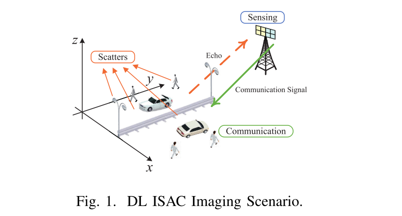
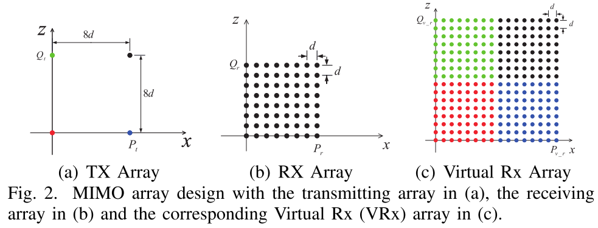
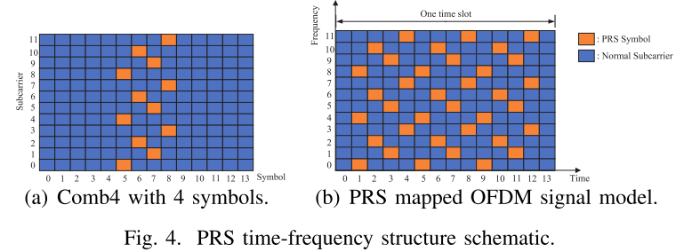
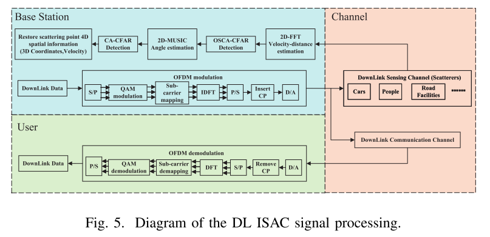
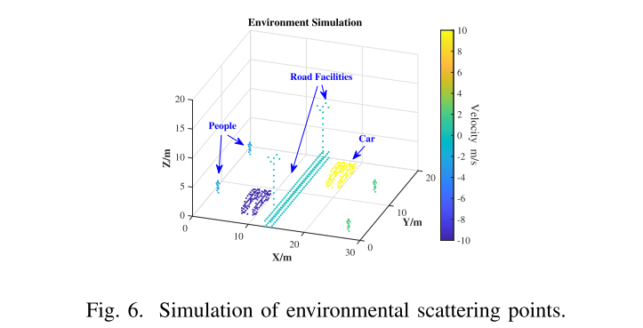
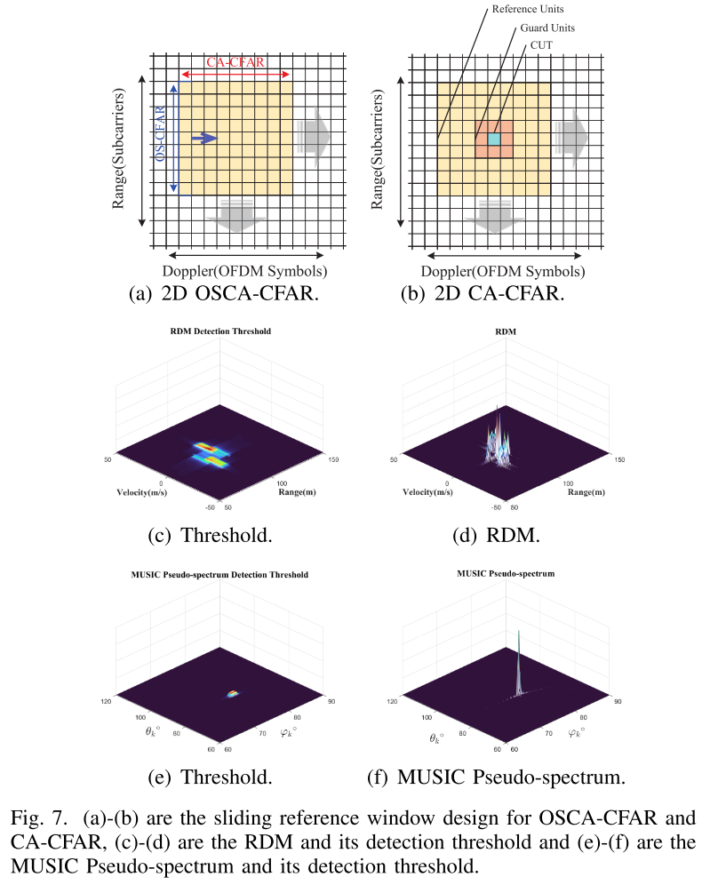
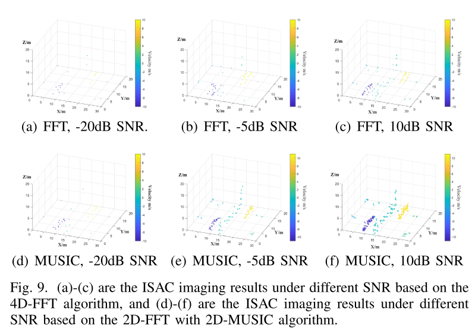
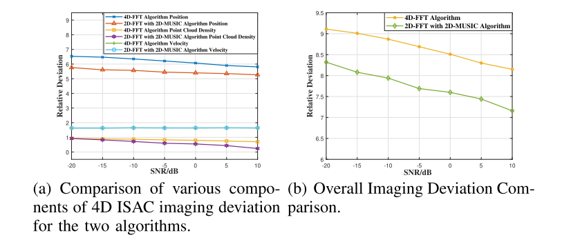

# [Good Article Sharing] ISAC 4D Imaging System Based on 5G Downlink Millimeter Wave Signal - [Attached MATLAB Code]

Introduction A. Background and Motivation
The development of 5G and 6G wireless communication towards higher frequency bands and larger bandwidths significantly enhances the perceptual capabilities of communication signals. Based on ISAC technology, imaging and 4D reconstruction in urban environments can be achieved using widely available wireless communication signals, which is of great significance for digital twins and smart city construction [1]. Compared to traditional imaging techniques, wireless imaging technology based on ISAC has advantages such as low deployment costs, privacy protection, and robustness under adverse weather conditions.
B. Relevant Works
Most work in the field of wireless imaging currently focuses on 3D or 4D imaging using Frequency Modulated Continuous Wave (FMCW) radar, which mainly uses FFT-based algorithms for echo signal processing [2]. Jiang et al. [3] proposed a wireless imaging method that incorporates dual-pulse repetition frequency (dual-PRF) waveforms into the Time Division Multiple Access (TDMA) and Doppler Frequency Division Multiplexing (DFDM) MIMO (TDMDDM-MIMO) framework and a super-resolution arrival direction (DoA) estimation deep convolutional neural network (CVDCN) to obtain high-resolution 4D point cloud images. Santra et al. [4] proposed an MIMO radar imaging scheme based on approximately orthogonal FMCW waveforms. Sun et al. [5] proposed a high-resolution imaging radar system using a virtual 2D sparse array. Compared to the MUSIC-based algorithm, the above FFT-based 4D imaging algorithm has limited resolution. Moreover, due to the poor communication capability of FMCW, it is not suitable for ISAC systems.
Based on OFDM, ISAC waveforms have been widely studied [6], but there is little work on four-dimensional imaging algorithms based on OFDM radar. Guan et al. [7] utilized 5G millimeter wave (mmWave) signals to construct a high-resolution 3D radar imaging system. In these works, there was a lack of estimation of target velocity, and the use of FFT-based signal processing algorithms resulted in significant restrictions on three-dimensional point cloud resolution.
To improve the resolution of DoA estimation and reduce the false alarm probability of 4D point cloud detection, related studies have introduced virtual aperture technology with constant false alarm rate (CFAR) detection [9]. However, the design of transmit and receive antennas for DL active perception in 5G NR BS has not been well designed, and the widely used CFAR detection algorithm cannot overcome the issue of missed detection of small targets caused by strong interference. Therefore, improving the design of transmit and receive antennas and CFAR detection algorithms is also a key issue in achieving ISAC scenarios for four-dimensional imaging.
C. Contributions
To address the above issues, an OFDM downlink ISAC imaging algorithm based on FFT and MUSIC is proposed. The main contributions and innovations of this paper are summarized as follows:
· We propose a BS-side active 4D imaging sensing algorithm that uses standard 5G NR mmWave signals containing Comb4 structure positioning reference signal (PRS). This algorithm can estimate the distance, velocity, azimuth angle, and elevation angle information (4D information) of a large number of scattering points simultaneously.
· A two-stage scattering point detection algorithm based on CFAR detection is proposed. The algorithm adopts OSCA (Ordered Statistics & Cell Averaging)-CFAR detection algorithm for the distance-Doppler map (RDM) obtained from 2D-FFT, and CA-CFAR detection algorithm for the 2D-MUSIC DoA estimation results. Compared with a single threshold method, it reduces the computational complexity and lowers the false alarm probability.
The article includes illustrations.
Conclusion: This paper proposes an ISAC 4D imaging system based on 2D-FFT and 2D-MUSIC. A two-level constant false alarm detection algorithm is proposed, which optimizes the DOA estimation and velocity-distance estimation process. A MIMO virtual aperture technology-based antenna layout for transceivers is designed. This paper introduces a new quality evaluation index for ISAC 4D imaging. Simulation results show that compared with other methods, this method can achieve higher point cloud density and higher imaging accuracy. In the future, we will construct an ISAC 4D imaging dataset and introduce deep learning models to realize more complex functions.

## Images

<!-- PAYMENT_BLOCK -->

## Get this dataset

- Payment link (Stripe): [Buy now](https://buy.stripe.com/3cs8yP7sY87d0vu9AB)
- Payment QR code: 

<!-- /PAYMENT_BLOCK -->
